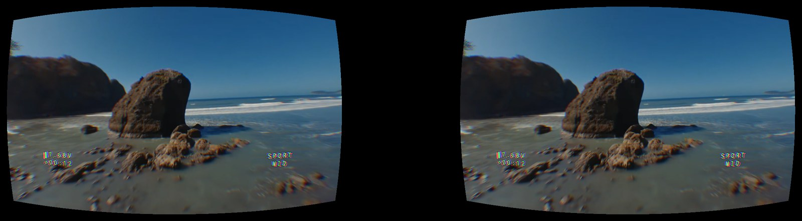
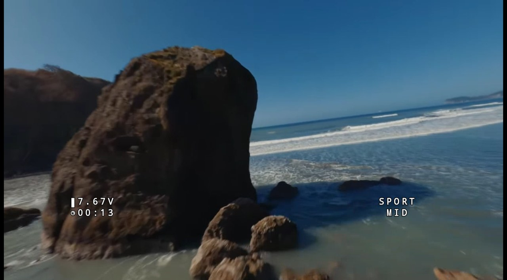
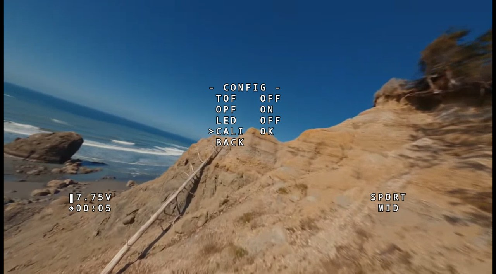
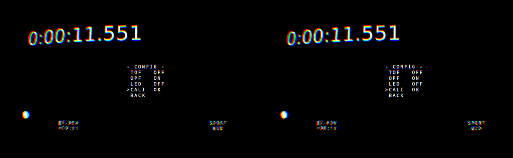
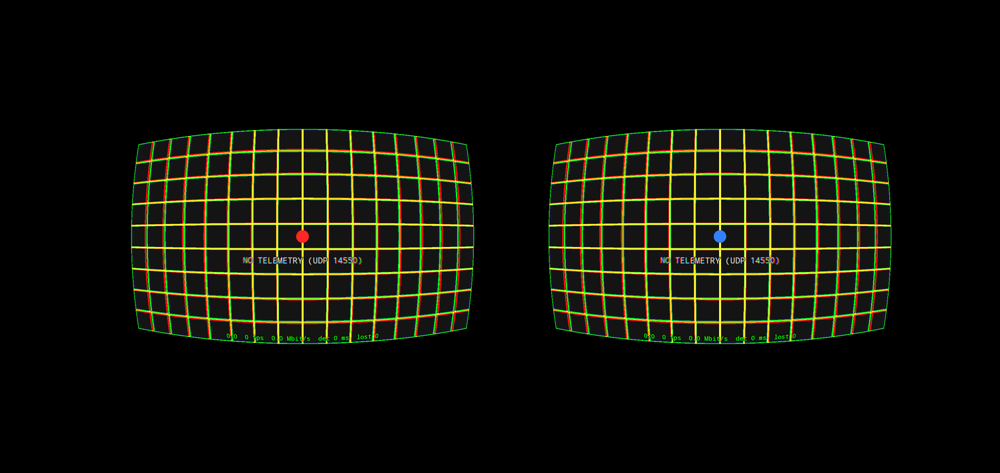

# FPV VR – OpenHD on your phone in VR goggles

[Türkçe → README_TR.md](README_TR.md) · **[Download the APK](../../releases/latest)**



An Android app that shows the **OpenHD** video and your flight controller's **OSD** on a phone that sits
in VR goggles (Samsung Gear VR, Google Cardboard, any "VR box" with two lenses), so it feels like DJI
goggles. It works together with the [fc-osd bridge](https://github.com/12enes34/OpenHD-Pavo_20_pocket_OSD/tree/fc-osd-bridge/tools/fc-osd). The FC's menus, warnings, voltage and
flight mode appear inside the picture, but the app also works with plain OpenHD.

* Side-by-side picture with lens distortion and colour-fringe correction.
* Hardware H.264 decoding in low-latency mode: about 5–6 ms on a Galaxy S10.
* FC OSD drawn by the phone, so the video is not re-encoded and no latency is added. Without the
  bridge, battery, flight mode, ARMED and an artificial horizon are shown from standard MAVLink.
* Alignment grid and sliders for eye spacing, shift, picture size, lens distortion and OSD area.
  Separate values are kept for each way the phone can be inserted.
* No internet, no account, no extra libraries. The APK is about 35 KB.

## Screenshots

| Flight OSD (voltage, timer, flight mode) | Flight controller menu, as in DJI goggles |
|---|---|
|  |  |



<sub>The phone screenshots were taken with a recorded FPV flight streamed to the app the way OpenHD
does it, plus simulated OSD data. The video is "Cinematic FPV Flight on Washington Coast – 4K" by
**Holler FPV**, [CC BY 3.0](https://creativecommons.org/licenses/by/3.0/), via
[Wikimedia Commons](https://commons.wikimedia.org/wiki/File:Cinematic_FPV_Flight_on_Washington_Coast_-_4K.webm).</sub>

## How it connects

```
OpenHD ground station ──USB cable──▶ phone (USB tethering ON) ──▶ FPV VR
     video  RTP/H.264  UDP 5600
     telemetry MAVLink UDP 14550   (both sent by OpenHD automatically to a USB-tethered phone)
```

OpenHD's ground station looks for a phone connected by **USB tethering** and then forwards video and
telemetry to it by itself. Nothing has to be configured in OpenHD.

## Install

1. Download `fpv-vr-<version>.apk` from the Releases page and open it on the phone. Android asks you to
   allow installing from this source.
2. Connect the phone to the OpenHD ground station with a USB cable.
3. Open **FPV VR**, tap the screen and press **USB tethering**. Switch on **USB tethering**. You have to
   do this every time the cable is plugged in; Android switches it off when the cable is removed.
4. Go back to the app. Within a few seconds the drone's video and OSD appear.

The tethering switch works without a SIM card. If the screen says *USB tethering OFF*, the switch is not
on yet.

## Fitting your goggles (once)



1. Tap the screen and choose a preset: **Samsung Gear VR** or **Cardboard / VR box**.
2. Switch on the **alignment grid**. The left eye shows a red dot, the right eye a blue dot.
3. Put the phone in the goggles and look with both eyes:
   * **Two dots side by side:** change **Eye spacing**. Red left of blue means the images are too far
     apart, so make it smaller. Red right of blue means they are too close, so make it larger.
   * **Picture not centred, or an edge cut off:** use **Horizontal shift** / **Vertical shift**.
   * **Corners blurry or half visible:** reduce **Picture size**, or reduce **OSD area** to move the OSD
     text towards the middle.
4. Switch the grid off. The settings are saved.

Eye spacing and horizontal shift are stored separately for each way the phone is inserted (charging
port left or right), because phones rarely sit exactly the same both ways. Use the goggles' focus wheel
for sharpness.

## Troubleshooting

| Screen shows | Meaning / fix |
|---|---|
| *USB tethering OFF* | Switch on USB tethering (tap the screen, then **USB tethering**). |
| *USB tethering on, waiting for the OpenHD ground station* | Start OpenHD on the ground. If it stays like this, unplug the cable, plug it back in and switch tethering on again. |
| *NO TELEMETRY* | Video works, but no MAVLink arrives. Check the FC connection on the air unit. |
| Picture stutters | Switch on **Statistics**. *lost* counts frames with missing packets, which comes from the radio link, not the phone. |

## Build it yourself

Requirements: JDK 17 and the Android SDK (platform 34).

```
echo sdk.dir=/path/to/Android/Sdk > local.properties
./gradlew assembleDebug          # app/build/outputs/apk/debug/app-debug.apk
```

For a signed release, put a `keystore.properties` (storeFile, storePassword, keyAlias, keyPassword) next to
`settings.gradle` and run `./gradlew assembleRelease`.

Code overview, in `app/src/main/java/io/github/fpvvr/`:

| File | Purpose |
|---|---|
| `VideoReceiver` | UDP/RTP → H.264 access units → MediaCodec onto a Surface |
| `Telemetry` | MAVLink parser, including the `OSD1` frames of the fc-osd bridge |
| `OsdPainter` | draws the OSD into a bitmap |
| `VrRenderer` | one OpenGL pass: eye split, lens pre-distortion, colour correction, video + OSD |
| `Settings`, `MainActivity` | settings, presets, settings panel |

Tested on a Samsung Galaxy S10 (Android 12) in a Samsung Gear VR with OpenHD 2.6.4.

## License

GPL-3.0, like OpenHD.
